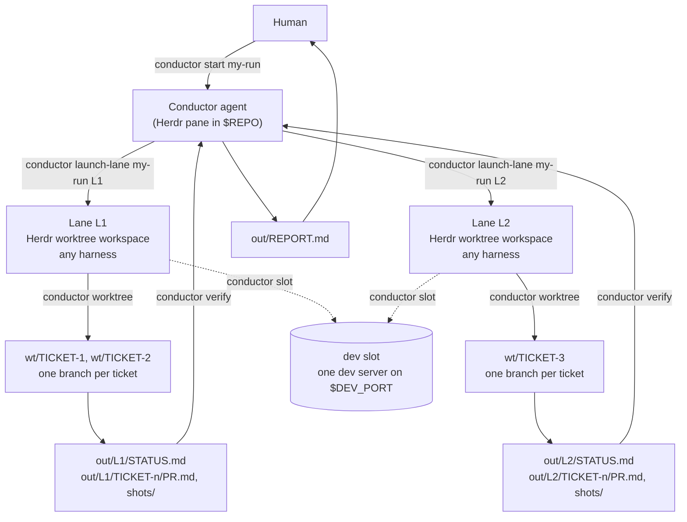

# agent-conductor

A conductor for parallel coding agents, built on [Herdr](https://herdr.dev). It works with any coding agent Herdr can start. One **conductor** agent splits a batch of tickets into **lanes**. It starts one coding agent per lane in its own Herdr worktree workspace, watches the lanes, checks their work itself (git state, gates, screenshots, PR bodies) and writes a report. Each lane can run a different harness: Claude Code, Codex, OpenCode, omp, Gemini CLI, or any other `herdr agent start --kind`. Everything stays on your machine. Nothing is pushed, merged, deployed or written to an issue tracker. You review the local branches and open the PRs yourself.



## Requirements

- [Herdr](https://herdr.dev) 0.9.5 or later ([source](https://github.com/herdrdev/herdr)). The conductor must run inside a Herdr pane.
- `git`, `jq`, `bash` (3.2 or later; the macOS system bash works), and `lsof` (or `ss` on Linux) for port checks.
- At least one coding agent CLI that Herdr supports. See [docs/harnesses.md](docs/harnesses.md).
- macOS or Linux.

## Install

Clone this repository, then put `bin/conductor` on your `PATH`:

```bash
cd agent-conductor
mkdir -p ~/.local/bin
ln -s "$PWD/bin/conductor" ~/.local/bin/conductor   # or add "$PWD/bin" to PATH
```

Run directories are created under `runs/` in this checkout (gitignored). Set `CONDUCTOR_RUNS_DIR` or pass `--runs-dir` to put them somewhere else.

## Quickstart

```bash
conductor new my-run --repo ~/src/my-app --kind claude
```

This creates `runs/my-run/` with every placeholder filled in, then prints the next steps. Edit these files before you launch:

1. `runs/my-run/run.env`: `GATES`, `INSTALL_CMD`, `DEV_CMD`/`DEV_PORT`/`DEV_READY_REGEX`, `COPY_FILES`, `LANE_ENV_FILE`, and `AGENT_ARGS`/`CONDUCTOR_ARGS` (permission flags and extra writable dirs for your harness; see [docs/harnesses.md](docs/harnesses.md)).
2. `runs/my-run/specs/SPECS.md`: one section per ticket with its base, branch, owned files and acceptance criteria, plus optional "Conductor notes" that override everything else.
3. `runs/my-run/lanes/L1-example.md`: rename it, and copy it once per lane (`lanes/<LANE>-<slug>.md`). Each lane file lists the files the lane owns, its tickets in order, test data and stop conditions.
4. `runs/my-run/CONDUCTOR.md`: fill in the Lanes table (lane, prompt file, kind, lane branch/base, tickets, dependencies).

Then, from a shell inside a Herdr pane:

```bash
conductor start my-run
```

`start` checks the run and Herdr, opens a pane next to yours (cwd `$REPO`) and starts the conductor agent there. The conductor then runs its own preflight (see below). Lanes show up in the Herdr sidebar as their own workspaces. Progress goes to `out/CONDUCTOR.md` and `out/<LANE>/STATUS.md`. `conductor status my-run` prints a snapshot. The run ends when the conductor replies `CONDUCTOR DONE …/out/REPORT.md`. Read `out/REPORT.md`, then review the branches in the merge order it gives.

## How a run works

### Conductor

The conductor never writes product code. It runs five phases from `CONDUCTOR.md`:

1. **Preflight.** It runs every check and stops with the full list of failures if any check fails. The checks: inside Herdr; every `COPY_FILES` entry and `LANE_ENV_FILE` exists (checked with `test -s`, never printed); the dev slot is free and nothing listens on `DEV_PORT`; `git fetch` succeeds and every base resolves; no lane or ticket branch exists yet; `out/` and `wt/` are empty; no Herdr agent names collide.
2. **Launch.** It runs `conductor launch-lane` once per lane whose dependencies are met. That creates a Herdr worktree workspace, copies `COPY_FILES`, runs `INSTALL_CMD`, exports `LANE_ENV_FILE`, starts the lane agent and sends it the lane prompt. If a first-start dialog holds the agent (exit 4), the conductor accepts a folder-trust dialog for the lane's own worktree and sends the prompt with `conductor prompt-lane`. Any other dialog is left for you. A lane that depends on another starts only after that lane is verified.
3. **Monitor.** It loops `conductor watch` and reads each lane's STATUS.md. A lane that goes idle without `LANE DONE` gets one nudge, then is marked stalled. A `blocked` lane gets an answer only to yes/no prompts about actions inside its own worktree, `$RUN/wt/`, `$RUN` or the dev slot. Everything else is recorded and left for you. A stuck slot held by this run can be force-released.
4. **Verify.** For each `done` ticket it runs `conductor verify --gates` and checks the results: HEAD matches the STATUS sha, the tree is clean, nothing is pushed, the base is an ancestor, gates pass, and the diff stays inside the ticket's owned files. It opens every screenshot and reads PR.md. A failure gets one corrective prompt. A second failure marks the ticket `rejected`.
5. **Report.** It writes `out/REPORT.md`: a per-ticket verdict table, merge order, follow-ups for you (tracker updates, deploy notes), every blocker and intervention, and the workspaces and worktrees left open for review.

### Lane

A lane is a coding agent that reads `LANE_RULES.md`, then its lane file. It takes its tickets in order, and for each one:

1. Run `conductor worktree` to get a fresh branch and worktree in `$RUN/wt/<TICKET>/`.
2. Take before screenshots under the dev slot, for UI changes.
3. Implement, through subagents if the harness has them, and add tests.
4. Run `$GATES`, do a browser check and take after screenshots under the dev slot, and open every PNG to confirm it.
5. Commit locally, write `out/<LANE>/<TICKET>/PR.md`, and add the ticket's line to `out/<LANE>/STATUS.md`.

A ticket that fails twice is marked `blocked` and the lane moves on. Stacked tickets are rebased when an earlier one changes. The lane finishes by replying `LANE DONE <path to STATUS.md>`.

### Run directory

```
runs/my-run/
  README.md            per-run human instructions
  run.env              run config (bash-sourceable KEY="value")
  CONDUCTOR.md         conductor prompt and Lanes table
  LANE_RULES.md        rules every lane reads first
  lanes/<LANE>-<slug>.md   one prompt per lane
  specs/SPECS.md       ticket specs; "Conductor notes" override everything
  wt/<TICKET>/         per-ticket git worktrees (created by `conductor worktree`)
  out/
    lanes.tsv          lane ledger: lane, agent, kind, workspace, pane, worktree, branch, base, started_utc
    CONDUCTOR.md       conductor's log
    <LANE>/STATUS.md   one line per ticket
    <LANE>/<TICKET>/PR.md          PR body draft (What / Why / Notes)
    <LANE>/<TICKET>/shots/*.png    before/after screenshots, never committed
    <LANE>/<TICKET>/gates.log      from `conductor verify --gates`
    REPORT.md          final report
```

Lane worktrees are created by `herdr worktree create`, and Herdr chooses their path. The `worktree` column of `out/lanes.tsv` records it. Lane branches default to `lane/<LANE>`.

### The dev slot

Many web apps can only be signed into on one fixed local origin. OAuth redirect URLs, auth proxies and allowed origins are configured for `localhost:<port>`, and browsers scope cookies by host, not by port, so several dev servers on `localhost` share and overwrite each other's sessions. Lanes therefore don't each run a dev server on a random port. They take turns on one dev server at `DEV_PORT`. `conductor slot` is a lock, global to the machine, at `${XDG_STATE_HOME:-$HOME/.local/state}/agent-conductor/locks/port-<PORT>`. It is shared across runs, so two runs on one machine also take turns. Acquiring fails (exit 3) if something else already listens on the port. A lane holds the slot for at most 20 minutes, signs in fresh each time, and before releasing it stops its server and confirms the port is free. With `DEV_CMD` empty there is no slot and no browser check.

### Safety model

- **Local only.** The prompts forbid push, PRs, merges, deploys, package publishing and tracker writes. `conductor verify` checks that nothing reached a remote branch.
- **The main checkout is read-only.** Agents never edit, commit or check out branches in `$REPO`. Only `git fetch` and `git worktree add/list` run against it. All work happens in worktrees.
- **No secrets in this repo.** `COPY_FILES` (for example `.env.local`) are copied from your main checkout into each new worktree, so the main checkout stays the source of truth. `LANE_ENV_FILE` (tokens, test-account credentials) lives outside the repo, or in the gitignored run dir, with `chmod 600`. It is exported into each lane's shell and never printed. `runs/` and `secrets/` are gitignored.
- **Permissions are your choice.** `AGENT_ARGS` and `CONDUCTOR_ARGS` decide how much each agent may do unprompted. Bypass flags remove the harness's own sandbox. The conductor's narrow approval handling is then the only fallback, and the prompt rules are instructions, not enforcement. See the safety note in [docs/harnesses.md](docs/harnesses.md#safety-note).
- **Herdr hygiene.** Agents close only panes they created, never stop the Herdr server, and leave workspaces and worktrees open for your review.

### Mixing harnesses

`AGENT_KIND` sets the default harness for lanes, and `CONDUCTOR_KIND` sets the conductor's. To put one lane on a different harness, write its kind and args in the Kind cell of the Lanes table in `CONDUCTOR.md`, for example `codex --args "--sandbox workspace-write --ask-for-approval on-request --add-dir /abs/run/dir …"` (the full Codex args are in [docs/harnesses.md](docs/harnesses.md#codex-cli-codex)). The conductor passes them as `conductor launch-lane <run> <LANE> --kind <k> --args "<a>"`. A lane on a non-default kind without `--args` starts with no extra args. Every harness has to reach `$RUN` and the slot lock. Per-harness flags are in [docs/harnesses.md](docs/harnesses.md).

## CLI reference

`<run>` is a run name (resolved under `${CONDUCTOR_RUNS_DIR:-<repo>/runs}`) or a path to a directory containing `run.env`.

| Command | Purpose |
|---|---|
| `conductor new <name> --repo <path> [--kind <k>] [--base <ref>] [--runs-dir <dir>]` | Scaffold a run directory from `templates/run/` and fill in placeholders and `run.env`. Refuses if the directory exists. |
| `conductor start <run> [--pane <id>] [--kind <k>] [--prompt-only]` | Preflight, split a pane (cwd `$REPO`) unless `--pane` is given, start the conductor agent and send it `Read <RUN>/CONDUCTOR.md and follow it exactly.`, settling first and confirming the turn started (as `prompt-lane` does). `--prompt-only` skips pane and agent creation and only prompts the existing `<run-name>-conductor` agent (exit 1 if it's gone or never settles); it can't be combined with `--pane` or `--kind`. Exits 4 if the conductor agent isn't ready after start: no prompt is sent, and it prints the pane id, a `herdr agent read` command and `conductor start <run> --prompt-only` as the next step. Exits 5 if the prompt was sent but no turn started: it never resends. Other failures exit 1. |
| `conductor launch-lane <run> <LANE> [--branch <b>] [--base <ref>] [--kind <k>] [--args "<a>"]` | Create the lane's Herdr worktree workspace, copy `COPY_FILES`, run `INSTALL_CMD`, export `LANE_ENV_FILE`, start and prompt the lane agent, and append and print its `lanes.tsv` row. Exits 4 if the agent isn't ready after start (any state other than `idle` or `done`, usually `blocked` on a startup dialog): the row is still written, no prompt is sent, and it prints the pane id and a `herdr agent read` command. Exits 5 if the prompt was sent but no turn started (see `prompt-lane`). Other failures exit 1. |
| `conductor prompt-lane <run> <LANE>` | Send the standard lane prompt to the lane in the last `lanes.tsv` row for `<LANE>`, for example after answering a startup dialog. Waits up to 30 s for the agent to settle at `idle` or `done` first, then confirms the turn started (`working`, or a state change) within 45 s and prints `prompted lane <LANE>: agent <agent>, turn started`. Refuses (exit 1) if the agent is gone or doesn't settle. Exits 5 if the turn isn't confirmed: it never resends, and prints the pane id, a `herdr agent read` command and what to do next. |
| `conductor worktree <run> <TICKET> --branch <b> [--base <ref>]` | Create the ticket worktree at `$RUN/wt/<TICKET>` on a new local branch (base defaults to `BASE_REF`), copy `COPY_FILES` and run `INSTALL_CMD`. Prints the path last. |
| `conductor slot <run> acquire <owner> [timeout_s]` / `release <owner>` / `status` / `force-release` | Machine-global dev-slot lock for `DEV_PORT`. `acquire` exits 3 if the port is already in use. `status` prints `free` or the owner line. |
| `conductor watch <run> [max_seconds] [--ignore L1,L2]` | Wait until any lane settles, or the timeout passes (default 1800 s), then print the status report. A lane settles when it is `blocked`, `done`, `unknown` or gone, or `idle` after a state change since `watch` started. |
| `conductor status <run>` | Status report: each lane's agent state, the slot owner, the port listener and STATUS.md times. |
| `conductor verify <run> <LANE> <TICKET> <base> [--gates]` | Show branch, HEAD, STATUS line, dirty files, pushed check, base ancestry, commits, diff stat and out files. `--gates` runs `$GATES` into `gates.log`. |
| `conductor help` | Usage. |

## Troubleshooting

- **A lane is stuck on a startup dialog.** Some harnesses ask on first start whether to trust a folder. Claude Code showed its folder-trust dialog for the first lane worktree of a repo it hadn't trusted, but not for a second worktree of the same repo (observed; see [Lane startup](docs/harnesses.md#lane-startup)). `launch-lane` then exits 4 without sending the prompt. Read the screen with the printed `herdr agent read` command, answer the dialog (`herdr agent send-keys <agent> <keys>`), then run `conductor prompt-lane <run> <LANE>`; it waits for the agent to settle before sending. The conductor does this itself for trust dialogs about the lane's own worktree. To clear one-time dialogs (bypass-mode warnings, logins, repo trust) ahead of time, start the harness once by hand with the same flags.
- **The conductor is stuck on a startup dialog.** `conductor start` exits 4 without sending the prompt. Answer the dialog in the conductor pane (read it with the printed `herdr agent read` command), then run `conductor start <run> --prompt-only`.
- **The prompt was sent but the agent never started (exit 5).** Right after a startup dialog the harness can still be initializing: Herdr accepts the prompt but the harness drops it, and the agent stays `idle`. `prompt-lane` and `start` wait for the agent to settle and confirm the turn started; if they can't, they exit 5 without resending. Read the screen: if the prompt text sits unsent in the input box, press Enter (`herdr agent send-keys <agent> enter`); if the input box is empty, run `conductor prompt-lane <run> <LANE>` (or `conductor start <run> --prompt-only` for the conductor) again.
- **A lane stops on every command.** Some permission modes still ask before most shell commands. Claude Code's `acceptEdits` prompts for nearly every Bash command, so the lane sits `blocked` until the conductor or you answer. For unattended lanes use the harness's auto or bypass mode, and read the trade-offs in [docs/harnesses.md](docs/harnesses.md) first.
- **`watch` keeps waiting although a lane is `idle`.** `watch` records each lane's last state change when it starts. A lane that is still `idle` from before `watch` started (for example, it hasn't picked up its prompt yet) doesn't count as settled, so `watch` keeps waiting until another lane settles or `max_seconds` passes. The report then marks that lane `idle (no change since watch start)`. A lane that goes `working` and then `idle` again does count, and so does a lane that turns `blocked`, `done` or `unknown`, or disappears.

## Supported harnesses

Any `herdr agent start --kind` value works. These have setup notes in [docs/harnesses.md](docs/harnesses.md):

| Harness | `--kind` | Instruction file | Subagents | Image viewing |
|---|---|---|---|---|
| Claude Code | `claude` | `CLAUDE.md` | yes | yes |
| Codex CLI | `codex` | `AGENTS.md` | yes | yes |
| OpenCode | `opencode` | `AGENTS.md` | yes | yes, with a vision model |
| omp | `omp` | `AGENTS.md` | yes | yes |
| Gemini CLI | `gemini` | `GEMINI.md` | v0.36.0+ | yes |

**Verified:** one full run passed end to end on 2026-10-22 with herdr 0.9.5 and Claude Code 2.1.304 as both conductor and lane: `conductor start`, `launch-lane`, `conductor worktree`, commit, STATUS.md and PR.md, `conductor verify --gates`, REPORT.md and `CONDUCTOR DONE`. The other harnesses haven't been run end to end; their notes come from local help and docs.

## Limitations

- A lane is only useful when it can work unattended. With strict approvals, every prompt stalls the lane until the conductor answers it (only for in-scope actions) or you do. Wider permissions mean more trust in the agent and in the prompt rules.
- There is one shared dev port per machine. Browser checks are serialized across all lanes and runs, so heavy UI work makes lanes wait for the slot.
- The conductor and lanes are agents following long Markdown prompts. How reliably they follow them depends on the harness and model. The conductor verifies git state, gates and screenshots itself, but it can't catch everything a lane misreads.
- Herdr's agent states (`working`, `idle`, `blocked`, `done`) drive monitoring. A harness whose state Herdr reports poorly is harder to monitor.

## License

MIT. See [LICENSE](LICENSE).
